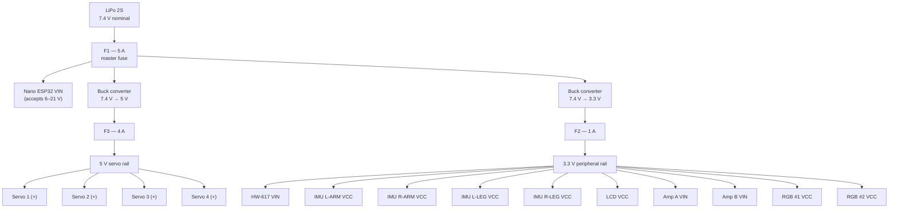
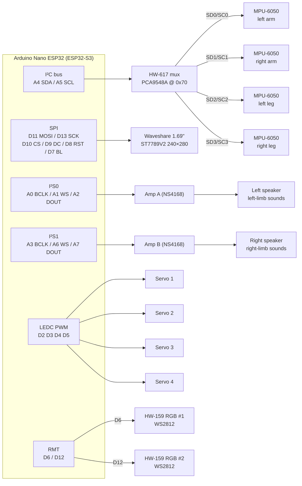

# mark85

Iron Man suit movement-sound system built on the **Arduino Nano ESP32**
(ESP32-S3). One IMU per limb (left arm, right arm, left leg, right leg) tracks
motion, and the firmware synthesizes the electro-mechanical sounds of the suit
in response, played through two I²S audio outputs: the left speaker plays
left-limb movement sounds, the right speaker plays right-limb movement sounds.
Servos, RGB lighting, and a status display complete the suit hardware.

## Hardware

| Component                                    | Qty | Interface  | Notes                                          |
| -------------------------------------------- | --- | ---------- | ---------------------------------------------- |
| Arduino Nano ESP32 (ESP32-S3)                | 1   | —          | 3.3 V logic on all GPIOs; powered via VIN      |
| LiPo 2S battery (7.4 V nominal)              | 1   | —          | Main power input                               |
| Buck converter, 7.4 V → 3.3 V                | 1   | —          | Peripheral rail (mux, IMUs, LCD, amps, RGB)    |
| Buck converter, 7.4 V → 5 V                  | 1   | —          | Servo rail only                                |
| Inline fuse F1 (5 A)                         | 1   | —          | Battery master fuse                            |
| Inline fuse F2 (1 A)                         | 1   | —          | 3.3 V rail output                              |
| Inline fuse F3 (4 A)                         | 1   | —          | 5 V servo rail output                          |
| MPU-6050 IMU (GY-521 style)                  | 4   | I²C @ 0x68 | One per limb: L/R arm, L/R leg, behind the mux |
| HW-617 I²C multiplexer (PCA9548A/TCA9548A)   | 1   | I²C @ 0x70 | 8 channels; we use 0–3                         |
| NS4168 I²S audio amp A (mono Class-D, 3 W)   | 1   | I²S0       | Left speaker — left arm/leg sounds             |
| NS4168 I²S audio amp B (mono Class-D, 3 W)   | 1   | I²S1       | Right speaker — right arm/leg sounds           |
| Speaker (4–8 Ω)                              | 2   | —          | One per amp                                    |
| Hobby servo                                  | 4   | PWM (LEDC) | Powered from the fused 5 V rail                |
| Waveshare 1.69" LCD, 240×280, ST7789V2       | 1   | SPI        | MOSI-only (no MISO needed)                     |
| HW-159 addressable RGB LED (WS2812/NeoPixel) | 2   | RMT        | Two independent data buses, no daisy chain     |

## Power distribution



**Ground:** every module's GND pin — Nano, both bucks, mux, all four IMUs,
LCD, both amps, all four servos, both RGB modules — returns to a **single
common ground** at the battery/buck negative. No exceptions; I²C, SPI, I²S,
and PWM all need it as their signal reference.

**Fuse rationale:**

- **F1 (5 A)** sits directly on the LiPo positive lead and protects the whole
  harness against any downstream short.
- **F3 (4 A)** protects the servo rail: four servos at ~1 A stall each is the
  worst case; a stalled/shorted servo blows F3 without dropping the logic
  rails, so the suit brain stays alive.
- **F2 (1 A)** protects the 3.3 V rail: all peripherals together draw well
  under 500 mA, so 1 A gives headroom while still catching a miswired module
  (as this project has learned, that happens).

**Flashing note:** USB can stay connected while the LiPo is attached — the
Nano ESP32 handles VIN and USB power simultaneously. Never tie the 5 V buck
output to the Nano's VBUS pin.

## Pin assignments (Nano ESP32)

| Nano pin | ESP32-S3 GPIO | Function      | Goes to           |
| -------- | ------------- | ------------- | ----------------- |
| A4       | GPIO11        | I²C SDA       | HW-617 SDA        |
| A5       | GPIO12        | I²C SCL       | HW-617 SCL        |
| D11      | GPIO38        | SPI MOSI      | LCD DIN           |
| D13      | GPIO48        | SPI SCK       | LCD CLK           |
| D10      | GPIO21        | LCD CS        | LCD CS            |
| D9       | GPIO18        | LCD DC        | LCD DC            |
| D8       | GPIO17        | LCD RST       | LCD RST           |
| D7       | GPIO10        | LCD backlight | LCD BL            |
| A0       | GPIO1         | I²S0 BCLK     | Amp A BCLK        |
| A1       | GPIO2         | I²S0 LRCLK/WS | Amp A LRC         |
| A2       | GPIO3         | I²S0 DOUT     | Amp A DIN         |
| A3       | GPIO4         | I²S1 BCLK     | Amp B BCLK        |
| A6       | GPIO13        | I²S1 LRCLK/WS | Amp B LRC         |
| A7       | GPIO14        | I²S1 DOUT     | Amp B DIN         |
| D2       | GPIO5         | Servo 1 PWM   | Servo 1 signal    |
| D3       | GPIO6         | Servo 2 PWM   | Servo 2 signal    |
| D4       | GPIO7         | Servo 3 PWM   | Servo 3 signal    |
| D5       | GPIO8         | Servo 4 PWM   | Servo 4 signal    |
| D6       | GPIO9         | RGB data 1    | HW-159 #1 DIN     |
| D12      | GPIO47        | RGB data 2    | HW-159 #2 DIN     |
| VIN      | —             | Board power   | F1 (fused LiPo +) |
| GND      | —             | Ground        | Common ground     |

Free for future use: `D0/RX`, `D1/TX`.

> **Note:** `D13` doubles as `LED_BUILTIN` on the Nano ESP32. Once the display
> is wired, the classic blink-on-13 sketch conflicts with SPI SCK — use the
> onboard RGB LED for status instead.

## Module-by-module wiring

Every pin of every module. Rail names refer to the power diagram above.

### HW-617 I²C multiplexer

| Mux pin    | Connects to           |
| ---------- | --------------------- |
| VIN        | 3.3 V rail (after F2) |
| GND        | Common ground         |
| SDA        | Nano A4               |
| SCL        | Nano A5               |
| A0, A1, A2 | GND (address 0x70)    |
| SD0 / SC0  | IMU L-ARM SDA / SCL   |
| SD1 / SC1  | IMU R-ARM SDA / SCL   |
| SD2 / SC2  | IMU L-LEG SDA / SCL   |
| SD3 / SC3  | IMU R-LEG SDA / SCL   |
| SD4–SD7    | Unused                |

### MPU-6050 IMUs (one per limb)

> ⚠️ The GY-521 header order is **VCC, GND, SCL, SDA** — SCL comes _before_
> SDA. Crossed bus wires scan as an empty bus (ask us how we know).

| IMU pin         | L-ARM      | R-ARM      | L-LEG      | R-LEG      |
| --------------- | ---------- | ---------- | ---------- | ---------- |
| VCC             | 3.3 V rail | 3.3 V rail | 3.3 V rail | 3.3 V rail |
| GND             | Common GND | Common GND | Common GND | Common GND |
| SCL             | Mux SC0    | Mux SC1    | Mux SC2    | Mux SC3    |
| SDA             | Mux SD0    | Mux SD1    | Mux SD2    | Mux SD3    |
| XDA/XCL/AD0/INT | Unused     | Unused     | Unused     | Unused     |

### Waveshare 1.69" LCD (ST7789V2)

| LCD pin | Connects to           |
| ------- | --------------------- |
| VCC     | 3.3 V rail (after F2) |
| GND     | Common ground         |
| DIN     | Nano D11 (MOSI)       |
| CLK     | Nano D13 (SCK)        |
| CS      | Nano D10              |
| DC      | Nano D9               |
| RST     | Nano D8               |
| BL      | Nano D7               |

### I²S audio amps (NS4168)

| Amp pin     | Amp A (left)  | Amp B (right) |
| ----------- | ------------- | ------------- |
| VCC         | 3.3 V rail    | 3.3 V rail    |
| GND         | Common ground | Common ground |
| BCLK        | Nano A0       | Nano A3       |
| LRC / WS    | Nano A1       | Nano A6       |
| DIN / SDATA | Nano A2       | Nano A7       |
| OUT+ / OUT− | Left speaker  | Right speaker |

The NS4168 is a mono Class-D amp with no gain or channel-select pins — just
power, the three I²S lines, and the speaker. It needs no MCLK. Rated ~3 W
into 4 Ω at 5 V; on the 3.3 V rail it runs quieter (~1 W), which keeps all
logic on one rail. If more volume is ever needed, its supply can move to the
5 V rail — the I²S inputs remain 3.3 V-compatible.

### Servos

| Servo pin       | Servo 1                   | Servo 2 | Servo 3 | Servo 4 |
| --------------- | ------------------------- | ------- | ------- | ------- |
| Signal (orange) | Nano D2                   | Nano D3 | Nano D4 | Nano D5 |
| V+ (red)        | 5 V servo rail (after F3) | same    | same    | same    |
| GND (brown)     | Common ground             | same    | same    | same    |

### HW-159 RGB modules (WS2812)

| RGB pin | RGB #1     | RGB #2     |
| ------- | ---------- | ---------- |
| VCC     | 3.3 V rail | 3.3 V rail |
| GND     | Common GND | Common GND |
| DIN     | Nano D6    | Nano D12   |

## Signal wiring diagram

Power edges are omitted here for readability — see the power diagram and the
per-module tables above for every VCC/GND connection.



## Feasibility notes

- **4× MPU-6050**: the MPU-6050 only offers two I²C addresses (0x68/0x69), so
  the HW-617 mux is the right call — each IMU gets its own channel and they
  can all keep the default 0x68. At 400 kHz I²C, reading full accel+gyro
  frames from all four sustains roughly 200–250 Hz per IMU including mux
  channel switches.
- **2× I²S out**: the ESP32-S3 has exactly two I²S peripherals, so two audio
  interfaces is the maximum — both are used here (both as outputs) with no
  headroom for a third. Audio runs on DMA, so it doesn't fight the CPU.
- **4 servos**: LEDC has 8 channels on the S3; four 50 Hz servo outputs are
  trivial (`ESP32Servo` library).
- **ST7789V2 240×280**: supported by Adafruit_ST7789 / LovyanGFX / TFT_eSPI —
  configure a 20-pixel row offset (the panel is 240×280 within a 240×320
  controller memory).
- **2× HW-159 (WS2812)**: driven by the S3's RMT peripheral, which has 4 TX
  channels — two independent buses are no problem and don't touch LEDC or I²S
  resources. Adafruit_NeoPixel and FastLED both handle multiple instances on
  separate pins out of the box. Powered at 3.3 V so the 3.3 V data signal
  stays in spec (a 5 V supply would need a level shifter on each data line).
- **Pin budget**: 20 of ~22 usable GPIOs are assigned; only the UART pair
  (`D0/D1`) remains free — the board is effectively full.

## Build & flash

```sh
pio run                            # build firmware
pio run -t upload                  # flash over USB (DFU)
pio test -e native                 # host unit tests
pio test -e arduino_nano_esp32     # on-target smoke tests (board attached)
```
