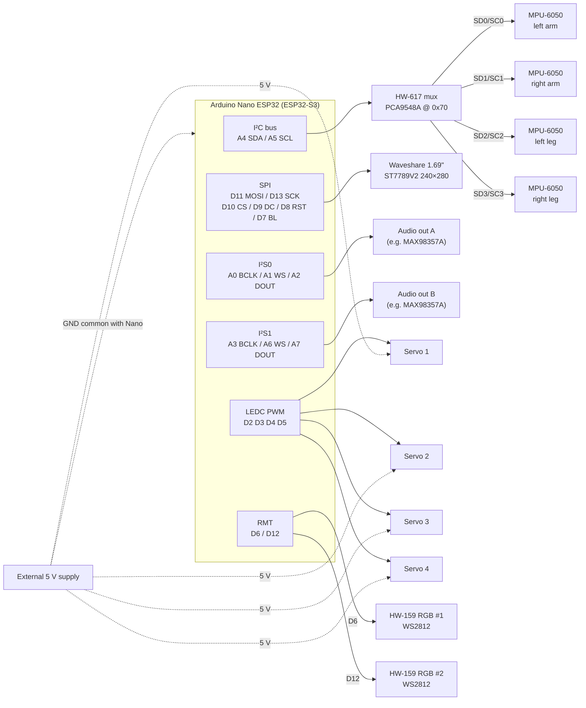

# mark85

Iron Man suit movement-sound system built on the **Arduino Nano ESP32**
(ESP32-S3). One IMU per limb (left arm, right arm, left leg, right leg) tracks
motion, and the firmware synthesizes the electro-mechanical sounds of the suit
in response, played through two I²S audio outputs. Servos, RGB lighting, and a
status display complete the suit hardware.

## Hardware

| Component                                     | Qty | Interface  | Notes                                          |
| --------------------------------------------- | --- | ---------- | ---------------------------------------------- |
| Arduino Nano ESP32 (ESP32-S3)                 | 1   | —          | 3.3 V logic on all GPIOs                       |
| MPU-6050 IMU (GY-521 style)                   | 4   | I²C @ 0x68 | One per limb: L/R arm, L/R leg, behind the mux |
| HW-617 I²C multiplexer (PCA9548A/TCA9548A)    | 1   | I²C @ 0x70 | 8 channels; we use 0–3                         |
| I²S audio output A (e.g. MAX98357A amp / DAC) | 1   | I²S0       | Movement sound effects — output only           |
| I²S audio output B (e.g. MAX98357A amp / DAC) | 1   | I²S1       | Movement sound effects — output only           |
| Hobby servo                                   | 4   | PWM (LEDC) | External 5 V supply required                   |
| Waveshare 1.69" LCD, 240×280, ST7789V2        | 1   | SPI        | MOSI-only (no MISO needed)                     |
| HW-159 addressable RGB LED (WS2812/NeoPixel)  | 2   | RMT        | Two independent data buses, no daisy chain     |

## Pin assignments

| Nano pin | ESP32-S3 GPIO | Function      | Goes to        |
| -------- | ------------- | ------------- | -------------- |
| A4       | GPIO11        | I²C SDA       | HW-617 SDA     |
| A5       | GPIO12        | I²C SCL       | HW-617 SCL     |
| D11      | GPIO38        | SPI MOSI      | LCD DIN        |
| D13      | GPIO48        | SPI SCK       | LCD CLK        |
| D10      | GPIO21        | LCD CS        | LCD CS         |
| D9       | GPIO18        | LCD DC        | LCD DC         |
| D8       | GPIO17        | LCD RST       | LCD RST        |
| D7       | GPIO10        | LCD backlight | LCD BL         |
| A0       | GPIO1         | I²S0 BCLK     | Audio A BCLK   |
| A1       | GPIO2         | I²S0 LRCLK/WS | Audio A LRC/WS |
| A2       | GPIO3         | I²S0 DOUT     | Audio A DIN    |
| A3       | GPIO4         | I²S1 BCLK     | Audio B BCLK   |
| A6       | GPIO13        | I²S1 LRCLK/WS | Audio B LRC/WS |
| A7       | GPIO14        | I²S1 DOUT     | Audio B DIN    |
| D2       | GPIO5         | Servo 1 PWM   | Servo 1 signal |
| D3       | GPIO6         | Servo 2 PWM   | Servo 2 signal |
| D4       | GPIO7         | Servo 3 PWM   | Servo 3 signal |
| D5       | GPIO8         | Servo 4 PWM   | Servo 4 signal |
| D6       | GPIO9         | RGB data 1    | HW-159 #1 DIN  |
| D12      | GPIO47        | RGB data 2    | HW-159 #2 DIN  |

Free for future use: `D0/RX`, `D1/TX`.

> **Note:** `D13` doubles as `LED_BUILTIN` on the Nano ESP32. Once the display
> is wired, the classic blink-on-13 sketch conflicts with SPI SCK — use the
> onboard RGB LED for status instead.

## Wiring diagram



### Power

- **3V3 rail** (from the Nano): HW-617, all four MPU-6050s, the LCD, and the
  I²S boards. Combined draw is well under 100 mA — fine from the onboard
  regulator.
- **Servos**: power from an **external 5 V supply** (budget ~1 A stall current
  per servo). Never feed them from the Nano's 3V3/5V pins. Tie the supply
  ground to the Nano's GND. The 3.3 V PWM signal is accepted by standard
  hobby servos.
- **HW-159 RGB modules**: power them from the **3V3 rail**, not 5 V. A WS2812
  needs a data-high level of ≥ 0.7 × VDD; at 5 V supply that's 3.5 V, which the
  S3's 3.3 V GPIO can't guarantee. At a 3.3 V supply the modules run slightly
  dimmer but the data levels are always valid — no level shifter needed. If
  you later want them at full 5 V brightness, add a level shifter (e.g.
  74AHCT125) on each data line.
- All I²C/SPI/I²S devices are 3.3 V — no level shifting needed anywhere.

## Feasibility notes

- **4× MPU-6050**: the MPU-6050 only offers two I²C addresses (0x68/0x69), so
  the HW-617 mux is the right call — each IMU gets its own channel and they
  can all keep the default 0x68. At 400 kHz I²C, reading full accel+gyro
  frames from all four sustains roughly 200–250 Hz per IMU including mux
  channel switches.
- **2× I²S out**: the ESP32-S3 has exactly two I²S peripherals, so two audio
  interfaces is the maximum — both are used here (both as outputs) with no
  headroom for a third. Audio runs on DMA, so it doesn't fight the CPU.
- **4 servos**: LEDC has 8 channels on the S3; four 50 Hz servo outputs are
  trivial (`ESP32Servo` library).
- **ST7789V2 240×280**: supported by Adafruit_ST7789 / LovyanGFX / TFT_eSPI —
  configure a 20-pixel row offset (the panel is 240×280 within a 240×320
  controller memory).
- **2× HW-159 (WS2812)**: driven by the S3's RMT peripheral, which has 4 TX
  channels — two independent buses are no problem and don't touch LEDC or I²S
  resources. Adafruit_NeoPixel and FastLED both handle multiple instances on
  separate pins out of the box.
- **Pin budget**: 20 of ~22 usable GPIOs are assigned; only the UART pair
  (`D0/D1`) remains free — the board is now effectively full.

## Build & flash

```sh
pio run              # build
pio run -t upload    # flash over USB (DFU)
```
