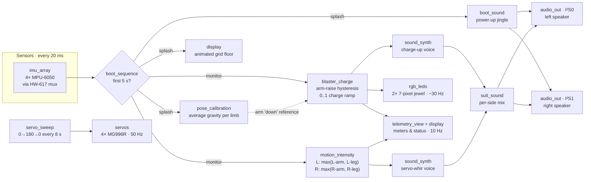
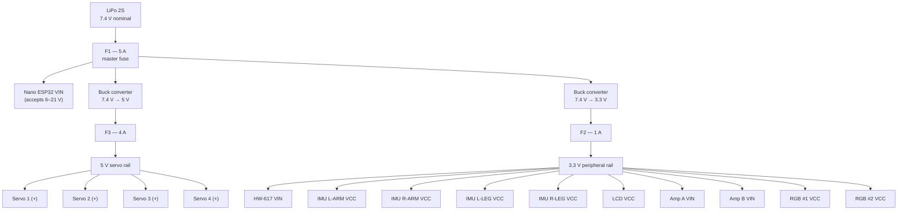
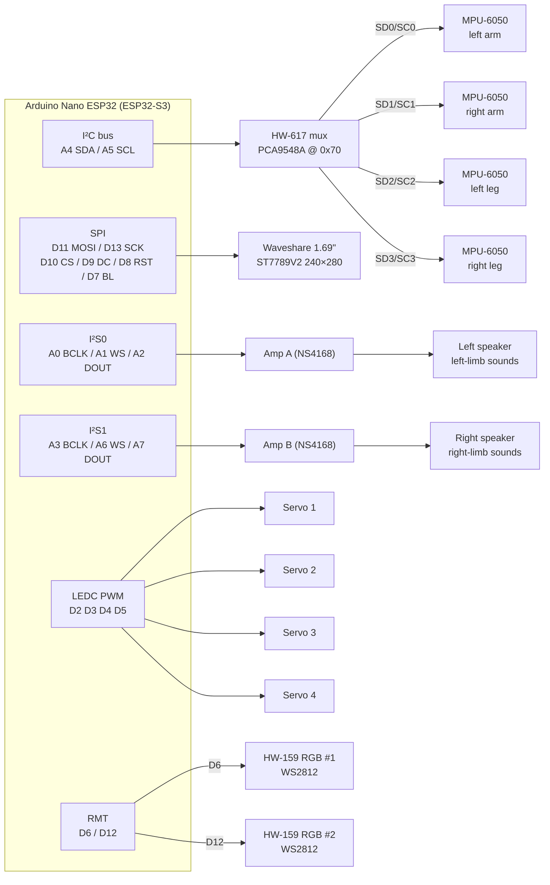

<div align="center">

# MARK 85

**Wearable Iron Man suit firmware: four limb IMUs in, synthesized servo-whir and repulsor charge-up out, in stereo.**

[](https://github.com/melucasleite/mark85/actions/workflows/ci.yml)


-E7352C?logo=espressif&logoColor=white>)


</div>

---

Every time the wearer moves, the suit answers. An MPU-6050 on each limb feeds a
**fully procedural sound synthesizer** on an Arduino Nano ESP32 (ESP32-S3):
movement becomes an electro-mechanical servo whir whose pitch and loudness track
how hard the limbs are working, and **raising an arm charges that hand's
repulsor** with a rising sweep and a 7-pixel LED jewel that fills as it powers
up. Left limbs play through the left speaker, right limbs through the right —
two independent I²S amplifiers, one per side. A vaporwave LCD shows boot splash
and live telemetry. No samples, no bitmaps: every sound and every pixel is
generated at runtime.

```text
 ┌────────────────────────┐      What the 240×280 LCD shows after boot
 │    MARK85 TELEMETRY    │      (layout of display.cpp's monitor screen)
 │ L-ARM ●     R-ARM ●    │  ←   limb online / offline dots
 │ L-LEG ●     R-LEG ●    │
 │ MOV L ▕██████░░░░░▏    │  ←   movement intensity, per side
 │ MOV R ▕███░░░░░░░░▏    │
 │ CHG L ▕█████████░░▏    │  ←   blaster charge, per hand
 │ CHG R ▕░░░░░░░░░░░▏    │
 │ CAL  L ●   R ●         │  ←   boot pose calibration result
 │ MUX ● AUD ● RGB ● SRV ●│  ←   subsystem health from setup()
 │ FLAPS 073              │
 │ UP 00:12:47            │
 │ ╲ ╲ ╲  ╲ │ ╱  ╱ ╱ ╱    │  ←   neon grid-floor footer
 └────────────────────────┘
```

## ✨ Highlights

- **Motion-reactive stereo sound.** Each side's intensity is the busier of its
  arm and leg gyro magnitudes (saturating at 200 °/s), smoothed with a fast
  attack (50 ms) and a slower release (300 ms) so the sound trails off like
  spinning-down machinery.
- **Procedural servo-whir voice.** A 70–330 Hz fundamental, an inharmonic
  partial at 2.71× for gear mesh, and a noise hiss, under an attack/release
  envelope that snaps to true silence at rest. Rendered at 22.05 kHz, 16-bit
  mono per channel.
- **Dual-hand repulsor blasters.** Raising an arm past ~120° from its rest
  pose charges that hand's blaster over ~1.2 s (lowering it winds down in
  ~0.3 s). Charge drives a 180 → 1430 Hz rising sweep with vibrato, mixed onto
  that side's channel, and the jewel LED: the ring fills clockwise from deep
  blue to cyan-white and the center ignites white once primed.
- **Mount-agnostic pose detection.** During the 5 s boot splash the wearer
  holds a neutral pose while each limb averages its gravity vector. Blaster
  detection measures the angle against that captured "down", so it works no
  matter how a sensor is strapped on — and a bad calibration leaves the
  blaster safely off.
- **Vaporwave UI.** A glitch-titled "JARVIS" splash with a slit sun, neon
  helmet silhouette, arc reactor and an animated perspective grid floor, then
  a live telemetry screen — all drawn from GFX primitives.
- **Boot jingle.** A 1.9 s retro power-up — chiptune arpeggio, servo wobble
  slide, final ding — on both speakers while calibration runs.
- **Tested off the hardware.** All behavior lives in hardware-free `domains/`
  code with 70 Unity test cases that run on the host and in GitHub Actions.

## 🧠 How it works

The firmware is split into thin **drivers** (one per peripheral, I/O only) and
pure **domains** (behavior, no Arduino headers, time passed in as a parameter).
`main.cpp` only schedules: there is no `delay()` in the loop, and every
subsystem runs on its own `millis()` cadence.



| Cadence         | What runs                                              |
| --------------- | ------------------------------------------------------ |
| 20 ms (50 Hz)   | Read all four IMUs; calibration or motion/blaster step |
| every loop pass | Top up both I²S DMA queues with 128-sample chunks      |
| 33 ms (~30 Hz)  | Blaster jewel LEDs (or splash floor animation)         |
| 20 ms (50 Hz)   | Servo angle update                                     |
| 100 ms (10 Hz)  | Telemetry screen dynamic values                        |

**Calibration acceptance.** A limb's neutral-pose window is accepted only with
≥ 50 samples, a mean magnitude of 0.8–1.2 g, a magnitude spread under 0.35 g
(i.e. the limb was still) and a directionality ratio ≥ 0.6. Otherwise the
telemetry `CAL` dot stays dim and that side's blaster is disabled.

**Blaster hysteresis.** Raised when the gravity/down cosine drops below −0.5
(~120°), lowered when it climbs back above 0 (~90°), with a 150 ms debounce so
a wobble at the threshold can't flicker the charge.

> **Status:** the servos currently run a slow bench-test sweep
> (`servo_sweep`), shown as `FLAPS` on the telemetry screen; it is a
> placeholder that will become flap control.

## 🔩 Hardware

| Component                                    | Qty | Interface  | Notes                                          |
| -------------------------------------------- | --- | ---------- | ---------------------------------------------- |
| Arduino Nano ESP32 (ESP32-S3)                | 1   | —          | 3.3 V logic on all GPIOs; powered via VIN      |
| LiPo 2S battery (7.4 V nominal)              | 1   | —          | Main power input                               |
| Buck converter, 7.4 V → 3.3 V                | 1   | —          | Peripheral rail (mux, IMUs, LCD, amps, RGB)    |
| Buck converter, 7.4 V → 5 V                  | 1   | —          | Servo rail only                                |
| Inline fuse F1 (5 A)                         | 1   | —          | Battery master fuse                            |
| Inline fuse F2 (1 A)                         | 1   | —          | 3.3 V rail output                              |
| Inline fuse F3 (4 A)                         | 1   | —          | 5 V servo rail output                          |
| MPU-6050 IMU (GY-521 style)                  | 4   | I²C @ 0x68 | One per limb: L/R arm, L/R leg, behind the mux |
| HW-617 I²C multiplexer (PCA9548A/TCA9548A)   | 1   | I²C @ 0x70 | 8 channels; we use 0–3                         |
| NS4168 I²S audio amp A (mono Class-D, 3 W)   | 1   | I²S0       | Left speaker — left arm/leg sounds             |
| NS4168 I²S audio amp B (mono Class-D, 3 W)   | 1   | I²S1       | Right speaker — right arm/leg sounds           |
| Speaker (4–8 Ω)                              | 2   | —          | One per amp                                    |
| MG996R servo                                 | 4   | PWM (LEDC) | Powered from the fused 5 V rail                |
| Waveshare 1.69" LCD, 240×280, ST7789V2       | 1   | SPI        | MOSI-only (no MISO needed)                     |
| HW-159 addressable RGB LED (WS2812/NeoPixel) | 2   | RMT        | 7-pixel jewels on two independent data buses   |

### ⚡ Power distribution



**Ground:** every module's GND pin — Nano, both bucks, mux, all four IMUs,
LCD, both amps, all four servos, both RGB modules — returns to a **single
common ground** at the battery/buck negative. No exceptions; I²C, SPI, I²S,
and PWM all need it as their signal reference.

**Fuse rationale:**

- **F1 (5 A)** sits directly on the LiPo positive lead and protects the whole
  harness against any downstream short.
- **F3 (4 A)** protects the servo rail. An MG996R stalls at ~2.5 A, so one
  jammed servo rides under the fuse while two jamming simultaneously blow it
  — by design: F3 goes before the wiring does, and the logic rails stay up,
  so the suit brain stays alive. In firmware, servos run at moderate speeds
  and never drive into their end-stops (600–2400 µs pulse range).
- **F2 (1 A)** protects the 3.3 V rail: all peripherals together draw well
  under 500 mA, so 1 A gives headroom while still catching a miswired module
  (as this project has learned, that happens).

**Flashing note:** USB can stay connected while the LiPo is attached — the
Nano ESP32 handles VIN and USB power simultaneously. Never tie the 5 V buck
output to the Nano's VBUS pin.

### 📌 Pin assignments (Nano ESP32)

All pins live in [`src/config.h`](src/config.h) as named `constexpr`s — the
single source of truth for hardware. The build sets
`-DBOARD_USES_HW_GPIO_NUMBERS` so the Arduino API takes raw ESP32-S3 GPIO
numbers.

| Nano pin | ESP32-S3 GPIO | Function      | Goes to           |
| -------- | ------------- | ------------- | ----------------- |
| A4       | GPIO11        | I²C SDA       | HW-617 SDA        |
| A5       | GPIO12        | I²C SCL       | HW-617 SCL        |
| D11      | GPIO38        | SPI MOSI      | LCD DIN           |
| D13      | GPIO48        | SPI SCK       | LCD CLK           |
| D10      | GPIO21        | LCD CS        | LCD CS            |
| D9       | GPIO18        | LCD DC        | LCD DC            |
| D8       | GPIO17        | LCD RST       | LCD RST           |
| D7       | GPIO10        | LCD backlight | LCD BL            |
| A0       | GPIO1         | I²S0 BCLK     | Amp A BCLK        |
| A1       | GPIO2         | I²S0 LRCLK/WS | Amp A LRC         |
| A2       | GPIO3         | I²S0 DOUT     | Amp A DIN         |
| A3       | GPIO4         | I²S1 BCLK     | Amp B BCLK        |
| A6       | GPIO13        | I²S1 LRCLK/WS | Amp B LRC         |
| A7       | GPIO14        | I²S1 DOUT     | Amp B DIN         |
| D2       | GPIO5         | Servo 1 PWM   | Servo 1 signal    |
| D3       | GPIO6         | Servo 2 PWM   | Servo 2 signal    |
| D4       | GPIO7         | Servo 3 PWM   | Servo 3 signal    |
| D5       | GPIO8         | Servo 4 PWM   | Servo 4 signal    |
| D6       | GPIO9         | RGB data 1    | HW-159 #1 DIN     |
| D12      | GPIO47        | RGB data 2    | HW-159 #2 DIN     |
| VIN      | —             | Board power   | F1 (fused LiPo +) |
| GND      | —             | Ground        | Common ground     |

Free for future use: `D0/RX`, `D1/TX`.

> **Note:** `D13` doubles as `LED_BUILTIN` on the Nano ESP32. Once the display
> is wired, the classic blink-on-13 sketch conflicts with SPI SCK — use the
> onboard RGB LED for status instead.

### 🔌 Signal wiring

Power edges are omitted here for readability — see the power diagram above and
the per-module tables below for every VCC/GND connection.



<details>
<summary><strong>Module-by-module wiring</strong> — every pin of every module</summary>

Rail names refer to the power diagram above.

#### HW-617 I²C multiplexer

| Mux pin    | Connects to           |
| ---------- | --------------------- |
| VIN        | 3.3 V rail (after F2) |
| GND        | Common ground         |
| SDA        | Nano A4               |
| SCL        | Nano A5               |
| A0, A1, A2 | GND (address 0x70)    |
| SD0 / SC0  | IMU L-ARM SDA / SCL   |
| SD1 / SC1  | IMU R-ARM SDA / SCL   |
| SD2 / SC2  | IMU L-LEG SDA / SCL   |
| SD3 / SC3  | IMU R-LEG SDA / SCL   |
| SD4–SD7    | Unused                |

#### MPU-6050 IMUs (one per limb)

> ⚠️ The GY-521 header order is **VCC, GND, SCL, SDA** — SCL comes _before_
> SDA. Crossed bus wires scan as an empty bus (ask us how we know).

| IMU pin         | L-ARM      | R-ARM      | L-LEG      | R-LEG      |
| --------------- | ---------- | ---------- | ---------- | ---------- |
| VCC             | 3.3 V rail | 3.3 V rail | 3.3 V rail | 3.3 V rail |
| GND             | Common GND | Common GND | Common GND | Common GND |
| SCL             | Mux SC0    | Mux SC1    | Mux SC2    | Mux SC3    |
| SDA             | Mux SD0    | Mux SD1    | Mux SD2    | Mux SD3    |
| XDA/XCL/AD0/INT | Unused     | Unused     | Unused     | Unused     |

#### Waveshare 1.69" LCD (ST7789V2)

| LCD pin | Connects to           |
| ------- | --------------------- |
| VCC     | 3.3 V rail (after F2) |
| GND     | Common ground         |
| DIN     | Nano D11 (MOSI)       |
| CLK     | Nano D13 (SCK)        |
| CS      | Nano D10              |
| DC      | Nano D9               |
| RST     | Nano D8               |
| BL      | Nano D7               |

#### I²S audio amps (NS4168)

| Amp pin     | Amp A (left)  | Amp B (right) |
| ----------- | ------------- | ------------- |
| VCC         | 3.3 V rail    | 3.3 V rail    |
| GND         | Common ground | Common ground |
| BCLK        | Nano A0       | Nano A3       |
| LRC / WS    | Nano A1       | Nano A6       |
| DIN / SDATA | Nano A2       | Nano A7       |
| OUT+ / OUT− | Left speaker  | Right speaker |

The NS4168 is a mono Class-D amp with no gain or channel-select pins — just
power, the three I²S lines, and the speaker. It needs no MCLK. Rated ~3 W
into 4 Ω at 5 V; on the 3.3 V rail it runs quieter (~1 W), which keeps all
logic on one rail. If more volume is ever needed, its supply can move to the
5 V rail — the I²S inputs remain 3.3 V-compatible.

#### Servos

| Servo pin       | Servo 1                   | Servo 2 | Servo 3 | Servo 4 |
| --------------- | ------------------------- | ------- | ------- | ------- |
| Signal (orange) | Nano D2                   | Nano D3 | Nano D4 | Nano D5 |
| V+ (red)        | 5 V servo rail (after F3) | same    | same    | same    |
| GND (brown)     | Common ground             | same    | same    | same    |

#### HW-159 RGB modules (WS2812)

| RGB pin | RGB #1     | RGB #2     |
| ------- | ---------- | ---------- |
| VCC     | 3.3 V rail | 3.3 V rail |
| GND     | Common GND | Common GND |
| DIN     | Nano D6    | Nano D12   |

</details>

### 🧪 Feasibility notes

- **4× MPU-6050**: the MPU-6050 only offers two I²C addresses (0x68/0x69), so
  the HW-617 mux is the right call — each IMU gets its own channel and they
  can all keep the default 0x68. At 400 kHz I²C, reading full accel+gyro
  frames from all four sustains roughly 200–250 Hz per IMU including mux
  channel switches; the firmware currently samples at 50 Hz.
- **2× I²S out**: the ESP32-S3 has exactly two I²S peripherals, so two audio
  interfaces is the maximum — both are used here (both as outputs) with no
  headroom for a third. Audio runs on DMA, so it doesn't fight the CPU, and
  underruns play silence rather than garbage.
- **4 servos**: LEDC has 8 channels on the S3; four 50 Hz servo outputs at
  14-bit resolution are trivial and are driven directly through LEDC.
- **ST7789V2 240×280**: driven with Adafruit_ST7789 at 40 MHz SPI, MOSI-only.
  The panel is 240×280 within a 240×320 controller memory, so it needs a
  20-pixel row offset — initializing the driver as `init(240, 280)` is what
  selects it.
- **2× HW-159 (WS2812)**: driven by the S3's RMT peripheral, which has 4 TX
  channels — two independent buses are no problem and don't touch LEDC or I²S
  resources. Adafruit_NeoPixel handles multiple instances on separate pins out
  of the box. Powered at 3.3 V so the 3.3 V data signal stays in spec (a 5 V
  supply would need a level shifter on each data line).
- **Pin budget**: 20 of ~22 usable GPIOs are assigned; only the UART pair
  (`D0/D1`) remains free — the board is effectively full.

## 🚀 Build, flash & test

Requires [PlatformIO](https://platformio.org/) (`pip install platformio`).
Library dependencies (Adafruit GFX, Adafruit ST7735/ST7789, Adafruit NeoPixel)
are pulled automatically from `platformio.ini`.

```sh
pio run                            # build firmware (env: arduino_nano_esp32)
pio run -t upload                  # flash over USB (DFU)
pio device monitor                 # serial monitor @ 115200 baud
pio test -e native                 # host unit tests — no board needed
pio test -e arduino_nano_esp32     # on-target smoke tests (board attached)
```

On boot the serial log reports the firmware version and every subsystem's
init result (`[display] ok`, `[audio L] ok`, `[imu] 0 L-ARM: ok`, …), then the
calibration outcome for each arm (`[cal] L-ARM ok, R-ARM ok`). A missing
peripheral is reported, not fatal.

### Testing strategy

| Tier               | Command                          | What it covers                                                                                                                                                          |
| ------------------ | -------------------------------- | ----------------------------------------------------------------------------------------------------------------------------------------------------------------------- |
| 🖥️ Host-native     | `pio test -e native`             | 10 suites / 70 Unity cases over every `domains/` module: synth, intensity smoothing, calibration gates, blaster hysteresis, boot timing, display line budgets, and more |
| 🔧 On-target smoke | `pio test -e arduino_nano_esp32` | I²C diagnostics: idle line levels, full bus scan (incl. swapped-pin check), mux at 0x70, left-arm IMU `WHO_AM_I`                                                        |
| ☁️ CI              | GitHub Actions                   | Runs the host-native suite on every push to `main` and every pull request                                                                                               |

Domains never include `Arduino.h` and receive time as a parameter, so every
state machine is deterministic and can be driven with synthetic IMU data —
including edge cases that are hard to produce physically. Run the on-target
test with `-v` to see the bus scan as a wiring diagnostic.

## 🗂️ Project layout

```text
mark85/
├── platformio.ini            # arduino_nano_esp32 + native test envs
├── src/
│   ├── main.cpp              # setup()/loop(): wiring and scheduling only
│   ├── config.h              # every pin, address, rate and timing constant
│   ├── version.h             # firmware semver (shown on splash + serial)
│   ├── drivers/              # thin hardware I/O, one pair per peripheral
│   │   ├── imu_array.*       #   4× MPU-6050 behind the HW-617 mux
│   │   ├── audio_out.*       #   I²S TX; two instances (I²S0 left, I²S1 right)
│   │   ├── display.*         #   ST7789V2 LCD, vaporwave splash + telemetry
│   │   ├── servos.*          #   4× MG996R on LEDC
│   │   └── rgb_leds.*        #   2× HW-159 jewels (NeoPixel)
│   └── domains/              # pure, host-testable behavior
│       ├── motion_intensity.*  # gyro → smoothed 0..1 effort per side
│       ├── sound_synth.*       # servo-whir + charge-up voices
│       ├── suit_sound.*        # limbs → left/right channel mix
│       ├── pose_calibration.*  # boot-time gravity "down" capture
│       ├── blaster_charge.*    # arm-raise detection, charge ramp, jewel LEDs
│       ├── boot_sequence.*     # splash → monitor phase timing
│       ├── boot_sound.*        # power-up jingle
│       ├── servo_sweep.*       # bench-test sweep (placeholder for flaps)
│       ├── telemetry_view.*    # fixed-width telemetry text lines
│       └── imu_telemetry.*     # limb naming
├── test/
│   ├── native/               # one test_<domain>/ suite per domain
│   └── embedded/             # on-target I²C smoke test
└── .github/workflows/ci.yml  # host tests on push / PR
```

Contributor conventions — drivers vs. domains, no dynamic allocation after
`setup()`, no `delay()` in the loop, display palette and render discipline,
semver bumps per feature — are documented in [`CLAUDE.md`](CLAUDE.md).
